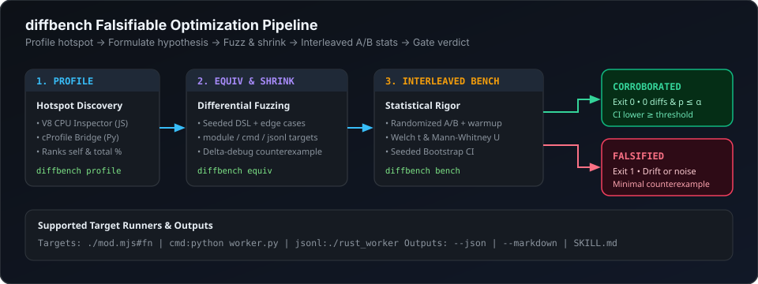
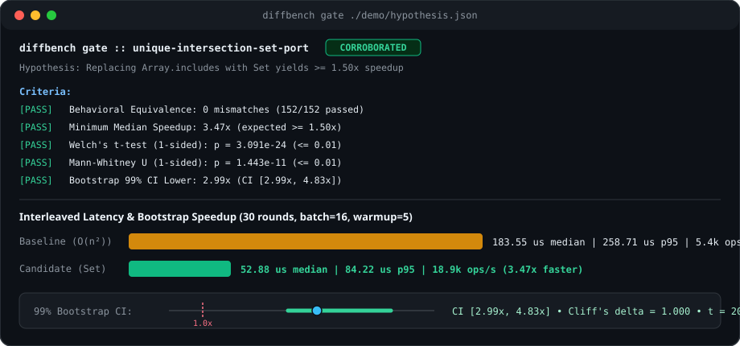
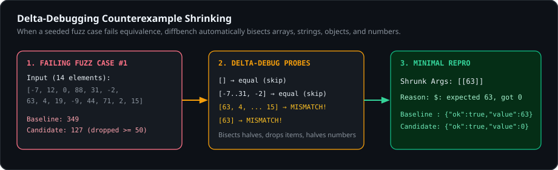

# diffbench


**Falsifiable optimization gate for developers and coding agents:** hotspot discovery (`V8 Inspector` & `cProfile`), differential equivalence fuzzing with delta-debugging counterexample shrinking, and statistically rigorous A/B benchmarking (`Welch's t-test`, `Mann-Whitney U`, and bootstrap confidence intervals).

Zero runtime dependencies. 100% local. No API keys required.

[](./LICENSE)
[](https://nodejs.org/)
[](./SKILL.md)
[](./docs/architecture.md)

---

## Why diffbench?

When you or a coding agent optimizes a hot function or ports a slow loop to another algorithm or language, two failure modes happen silently:

1. **Silent behavioral drift:** edge cases (`-0`, `NaN`, empty arrays, Unicode, thrown errors, boundary thresholds) diverge between baseline and candidate.
2. **Benchmark theater:** uncalibrated timers or a lucky run look "2x faster", when the difference is indistinguishable from CPU jitter or thermal drift.

`diffbench` turns optimization claims into **falsifiable hypotheses**:
- **Profile first:** locate the slow 5% using Node's built-in V8 CPU profiler or Python's `cProfile`.
- **Fuzz & shrink:** test adversarial edge cases plus seeded property-based inputs, automatically shrinking any failing input down to a minimal counterexample.
- **Prove speedup statistically:** interleave randomized `A/B` batches with auto-calibrated batching and gate on minimum median speedup, `Welch's t-test`, `Mann-Whitney U`, and the lower bound of a seeded bootstrap confidence interval.



---

## Quick Start

```bash
npm install -g diffbench
# or run from source:
npm install && npm run build
```

Scaffold a runnable experiment (`baseline.mjs`, `candidate.mjs`, and `hypothesis.json`):

```bash
diffbench init --dir ./demo
diffbench gate ./demo/hypothesis.json
```



Verified output from running `diffbench gate ./demo/hypothesis.json --no-color`:

```text
diffbench gate :: unique-intersection-set-port [CORROBORATED]
Hypothesis: Replacing quadratic Array.includes lookups with Set membership yields >= 1.50x median speedup with zero behavioral drift.

Criteria:
  [PASS] Behavioral Equivalence: 0 mismatches (152/152 passed) (expected 0 mismatches across 152 cases)
  [PASS] Minimum Median Speedup: 3.47x (expected >= 1.50x)
  [PASS] Welch's t-test (one-sided): p = 3.091e-24 (expected p <= 0.01)
  [PASS] Mann-Whitney U (one-sided): p = 1.443e-11 (expected p <= 0.01)
  [PASS] Bootstrap 99% CI Lower Bound: 2.99x (CI [2.99x, 4.83x]) (expected >= 1.20x)

diffbench equiv  [PASS]
  Baseline : ./baseline.mjs#uniqueIntersection
  Candidate: ./candidate.mjs#uniqueIntersection
  Cases    : 152/152 passed (edge=2, random=150, corpus=0, seed=42)
  Duration : 93.8 ms

diffbench bench  (30 interleaved rounds, batch=16, warmup=5)
  Baseline  : 183.55 us median | 258.71 us p95 | 5.4k ops/s (outliers=2)
  Candidate : 52.88 us median | 84.22 us p95 | 18.9k ops/s (outliers=0)
  Speedup   : 3.47x faster (99% CI [2.99x, 4.83x])
  Welch t   : t=20.892, df=42.4, p=3.091e-24
  Mann-Whit : z=6.653, p=1.443e-11, cliff=1.000
```

---

## Catching & Shrinking Behavioral Bugs

When a candidate diverges on a random array, delta debugging reduces the input to a minimal counterexample:



```bash
diffbench equiv \
  --baseline ./a.mjs#sumPos \
  --candidate ./b.mjs#sumPos \
  --schema "array<int(-10,100)>(5,20)" \
  --iterations 80
```

Verified output:

```text
diffbench equiv  [FAIL]
  Baseline : ./a.mjs#sumPos
  Candidate: ./b.mjs#sumPos
  Cases    : 1/2 passed (edge=1, random=1, corpus=0, seed=42)
  Duration : 7.0 ms

  Counterexample found at case #1 (random, shrunk in 150 probes):
    Reason      : $: expected 63, got 0
    Shrunk Args : [[63]]
    Baseline Out: {"ok":true,"value":63}
    CandidateOut: {"ok":true,"value":0}
```

---

## Profiling Hotspots

Profile a JS/ESM function via V8 Inspector (`node:inspector/promises`) or a Python script via `cProfile`:

```bash
diffbench profile ./demo/baseline.mjs#uniqueIntersection \
  --schema "array<int(-500,500)>(200,400), array<int(-500,500)>(200,400)" \
  --duration-ms 150 --top 5

diffbench profile ./work.py --top 3
```

---

## Cross-Language Targets (`cmd:` and `jsonl:`)

Verify ports between Node, Python, Rust, Go, or C binaries using either:
- **ESM/JS export:** `./path/file.mjs#exportName`
- **One-shot stdin/stdout executable:** `"cmd:python worker.py"` (receives JSON argument array on `stdin`, emits `{"ok": true, "value": ...}` on `stdout`)
- **Persistent NDJSON worker:** `"jsonl:./target/release/fast_worker"` (reads one JSON argument array per line on `stdin`, writes one JSON result line on `stdout`)

See [Cross-Language Workers](./docs/cross-language-workers.md) for Python and worker protocol templates.

---

## Schema DSL Reference

Pass positional argument schemas as comma-separated expressions via `--schema`:
- Primitives: `int(min,max)`, `float(min,max)` (add `special` for `NaN`/`Infinity`), `bool`, `null`, `string(minLen,maxLen)`
- Combinators: `enum<a,b,c>`, `nullable<T>`, `array<T>(minLen,maxLen)`, `tuple<T1,T2>`, `record<k1:T1,k2:T2>`, `map<T>(minKeys,maxKeys)`
- Or supply `--cases cases.json` with a static corpus array (`[[arg1, arg2], ...]` or `{"cases": [...]}`).

Full syntax and edge-case rules are documented in [Schema DSL & Edge-Case Generation](./docs/schema-dsl.md).

---

## Documentation

| Guide | Topic |
| --- | --- |
| [Docs Hub](./docs/README.md) | Documentation index & overview |
| [Architecture](./docs/architecture.md) | Internal pipeline, runner adapters, and execution flow |
| [CLI Reference](./docs/cli-reference.md) | Subcommands, flags, exit codes, and `hypothesis.json` spec |
| [Schema DSL](./docs/schema-dsl.md) | Input generators, adversarial edge cases, and shrinking |
| [Statistical Methodology](./docs/statistical-methodology.md) | Auto-calibration, Welch's t-test, Mann-Whitney U, and bootstrap CIs |
| [Cross-Language Workers](./docs/cross-language-workers.md) | `cmd:` & `jsonl:` protocols for Python, Rust, Go, and C |
| [CI & Coding Agents](./docs/ci-and-agents.md) | GitHub Actions summaries and [`SKILL.md`](./SKILL.md) workflows |

---

## Architecture

- [`src/prng.ts`](./src/prng.ts) — Deterministic 32-bit seeded PRNG (`Mulberry32`) for reproducible fuzzing, A/B interleaving, and bootstrap resampling.
- [`src/schema.ts`](./src/schema.ts) — Recursive schema DSL parser, random generator, adversarial edge-case injector, and corpus loader.
- [`src/runners.ts`](./src/runners.ts) — Target adapters (`module`, `cmd:`, `jsonl:`) with mtime/size ESM cache busting.
- [`src/equivalence.ts`](./src/equivalence.ts) — Deep value & error-parity comparator plus delta-debugging counterexample shrinker.
- [`src/stats.ts`](./src/stats.ts) — Descriptive metrics, Welch's two-sample t-test (exact Student's t CDF via incomplete beta), Mann-Whitney U with tie correction, Cliff's delta, and bootstrap CIs.
- [`src/benchmark.ts`](./src/benchmark.ts) — Batch auto-calibration, dead-code sink, randomized A/B rounds, and heap delta tracking.
- [`src/profiler.ts`](./src/profiler.ts) — V8 Inspector CPU sampling profiler and Python `cProfile` bridge.
- [`src/hypothesis.ts`](./src/hypothesis.ts) & [`src/cli.ts`](./src/cli.ts) — Hypothesis gate evaluator, formatter pipeline, and CLI entrypoint.

## License

[MIT](./LICENSE) © 2026 md1qamar
