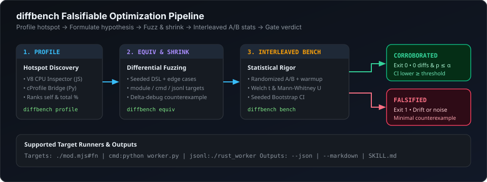

# Architecture

`diffbench` is structured as a modular, zero-dependency TypeScript pipeline that keeps every random choice, equivalence comparison, and timing measurement deterministic and reproducible.

## Module Map

| Module | Responsibility |
| --- | --- |
| [`src/prng.ts`](../src/prng.ts) | `SeededRng` (Mulberry32) used across input generation, randomized `A/B` ordering, and bootstrap resampling. |
| [`src/schema.ts`](../src/schema.ts) | Parses schema DSL strings or JSON schemas, generates seeded random arguments, builds boundary edge cases, and loads `--cases` JSON files. |
| [`src/runners.ts`](../src/runners.ts) | Uniform `TargetRunner` interface for ESM exports (`file#fn`), one-shot executables (`cmd:`), and persistent NDJSON workers (`jsonl:`). |
| [`src/equivalence.ts`](../src/equivalence.ts) | Deep value comparator (`compareValues`), error-parity check (`compareOutcomes`), fuzzing loop (`runEquivalenceCheck`), and delta-debugging shrinker (`shrinkCounterexample`). |
| [`src/stats.ts`](../src/stats.ts) | Descriptive quantiles/MAD/IQR outliers, Welch's t-test with exact incomplete beta Student's t CDF, Mann-Whitney U with tie correction & Cliff's delta, and percentile bootstrap CIs. |
| [`src/benchmark.ts`](../src/benchmark.ts) | Batch size auto-calibration, dead-code sink, warmup, randomized interleaved `A/B` rounds, and heap-delta sampling. |
| [`src/profiler.ts`](../src/profiler.ts) | Local V8 Inspector CPU sampling (`node:inspector/promises`) for JS/ESM and `cProfile` JSON bridge for Python `.py` targets. |
| [`src/hypothesis.ts`](../src/hypothesis.ts) | Evaluates `HypothesisSpec` files (`CORROBORATED` vs `FALSIFIED`) and scaffolds starter experiments via `scaffoldHypothesisWorkspace`. |
| [`src/formatters.ts`](../src/formatters.ts) | Renders `pretty` (ANSI), `json`, and `markdown` reports. |
| [`src/cli.ts`](../src/cli.ts) | Parses flags and dispatches `gate`, `equiv`, `bench`, `profile`, and `init`. |

## Execution Flow in `diffbench gate`

1. **Runner Initialization (`loadTargetRunner`)**
   - ESM modules are imported with `pathToFileURL(absPath)` plus an `?v=${mtimeMs}-${size}` query parameter so iterative edits in long-lived processes never hit stale ESM module cache entries.
   - Subprocess workers (`cmd:` / `jsonl:`) parse command strings safely without shell injection (`parseCommandLine`) and cleanly close stdio handles in `finally`.
2. **Differential Equivalence (`runEquivalenceCheck`)**
   - Combines static corpus entries (`--cases`), targeted edge cases (`buildEdgeCases`), and `iterations` seeded random argument tuples (`generateArgs`).
   - Clones inputs before passing to `baseline` and `candidate` sequentially so in-place mutations in one target cannot corrupt the other.
   - On any divergence, `shrinkCounterexample` runs up to `150` delta-debugging probes to isolate a minimal failing input.
3. **Interleaved A/B Benchmarking (`runBenchmark`)**
   - Only runs when behavioral equivalence passes (`0` mismatches).
   - Auto-calibrates `batchSize` for `module` targets toward `~4 ms` per round (capped at `20,000` ops) and runs `warmupRounds` before collecting `sampleRounds` paired timings via `process.hrtime.bigint()`.
   - Randomizes `baseline -> candidate` vs `candidate -> baseline` order per round to neutralize thermal throttling and background noise.
4. **Statistical Gate (`evaluateGate`)**
   - Checks all five criteria: behavioral equivalence, minimum median speedup, one-sided Welch's t-test `p <= maxPValue`, one-sided Mann-Whitney U `p <= maxPValue`, and bootstrap CI lower bound `>= requireCiLowerAbove`.
   - Exits `0` only if every criterion passes (`CORROBORATED`); otherwise exits `1` (`FALSIFIED`) with explicit `falsificationReasons`.
