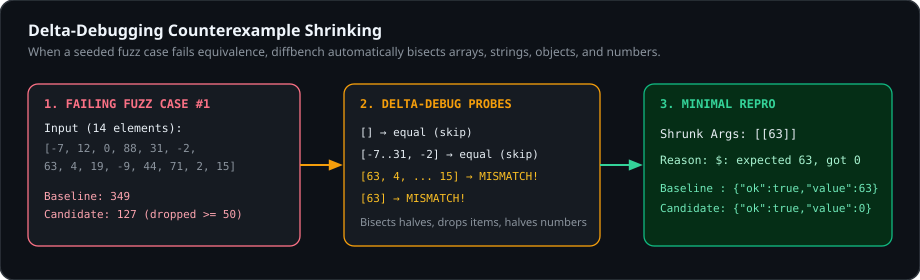

# Schema DSL & Edge-Case Generation

`diffbench` uses a compact positional Schema DSL (or JSON schema objects) to generate deterministic random inputs and targeted adversarial boundary cases.

## Positional Argument DSL

Multiple function arguments are separated by top-level commas:

```text
--schema "array<int(-100,100)>(0,50), int(0,25), enum<asc,desc>"
```

That generates a 3-argument vector `[arr, limit, order]` passed via `fn(...args)` (or as a JSON array `[arr, limit, order]` to subprocess workers).

### Supported Types

| Type | Syntax | Defaults | Notes |
| --- | --- | --- | --- |
| Integer | `int(min,max)` / `integer(min,max)` | `-1000` .. `1000` | Inclusive integer bounds. |
| Float | `float(min,max[,special])` / `number(...)` | `-1000` .. `1000` | Add `special` to include `NaN`, `Infinity`, `-Infinity` in edge cases. |
| Boolean | `bool` / `boolean` | — | `true` / `false`. |
| Null | `null` | — | Always `null`. |
| String | `string(maxLen)` or `string(minLen,maxLen)` | `0` .. `48` | Mixes ASCII and Unicode fragments (`é`, `ñ`, `π`, `🚀`). |
| Enum | `enum<a,b,1,true,null>` | — | Parses booleans, `null`, numbers, or strings. |
| Nullable | `nullable<T>` | 20% `null` | Wraps any nested schema node `T`. |
| Array | `array<T>(maxLen)` or `array<T>(minLen,maxLen)` | `0` .. `64` | Homogeneous variable-length array (`list<T>` alias supported). |
| Tuple | `tuple<T1,T2,...>` | — | Fixed-length positional tuple. |
| Record | `record<k1:T1,k2:T2>` | — | Fixed-shape plain object (`object<...>` alias supported). |
| Map / Dict | `map<T>(minKeys,maxKeys)` | `0` .. `16` | Variable-key object dictionary (`dict<T>` alias supported). |

### JSON Schema Input

You can also pass raw JSON (array of `SchemaNode` objects or a single `SchemaNode`) inside `hypothesis.json` or `--schema`:

```json
[
  {
    "kind": "record",
    "fields": {
      "id": { "kind": "int", "min": 1, "max": 1000 },
      "tags": { "kind": "array", "item": { "kind": "string", "maxLen": 16 }, "minLen": 0, "maxLen": 8 }
    }
  }
]
```

---

## Adversarial Edge-Case Injection

Unless `--no-edge-cases` is passed, `diffbench` runs a targeted boundary suite before random fuzzing (`buildEdgeCases`, capped at 64 combinations):

- **`int`:** `min`, `max`, `min + 1`, `max - 1`, `-1`, `0`, `1` (filtered to `[min, max]`)
- **`float`:** bounds, `±1`, `±0.5`, `±1e-9`, `-0`, plus `NaN`, `Infinity`, `-Infinity` when `special` is enabled
- **`string`:** `""`, `" "`, `"a"`, `"hello world"`, `"line1\nline2\ttab"`, `"café naïve 🚀"`, combining accent `"a\u0301b"`, `"__proto__"`, `"constructor"`, `'{"quoted":"value"}'` (clamped to `[minLen, maxLen]`)
- **`array`:** `[]` (if `minLen === 0`), `[first]`, `[last]`, `[first, first]`, `[first, last]`, `[last, first]`, alternating pattern `[first, last, first, last]`

## Delta-Debugging Shrinking



When a random or corpus input fails `compareOutcomes`, `shrinkCounterexample` runs up to `150` deterministic probes:
1. Replaces numbers with `0`, flips negative to positive, halves, and steps toward zero.
2. Halves and trims strings and arrays, drops individual array elements, and shrinks elements recursively.
3. Drops keys from objects and shrinks nested field values.

## Static Corpus Files (`--cases`)

Supply regression test vectors alongside or instead of `--schema`:

```json
{
  "cases": [
    [[1, 2, 3], [2, 3, 4]],
    [[], [1]],
    [[-0, 0], [-0]]
  ]
}
```

Single-argument non-array scalars in a JSON list (`[10, 20, 30]`) are automatically wrapped as `[[10], [20], [30]]`.
