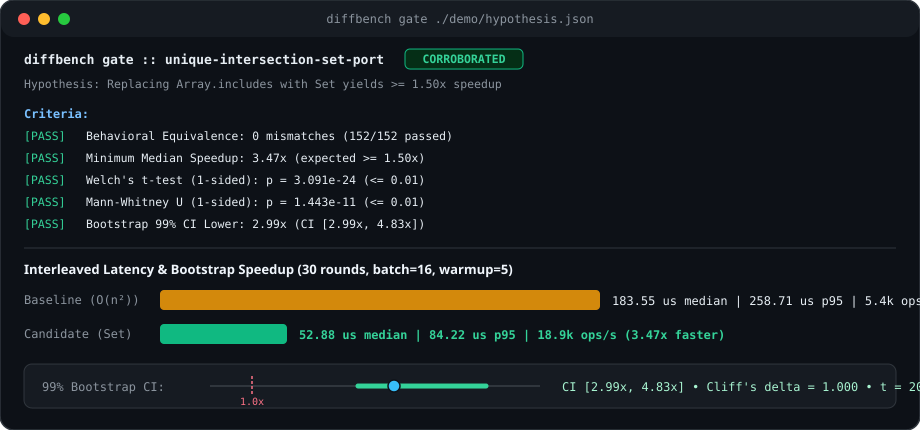

# Statistical Methodology

Single-run wall-clock timings are notoriously noisy: JIT warmup, garbage collection pauses, CPU frequency scaling, and background OS work regularly create false "2x speedups". `diffbench` combines experimental isolation with parametric and non-parametric inference.

## 1. Measurement Hygiene

- **Batch Auto-Calibration:** Sub-millisecond functions suffer from timer quantization and loop overhead. For `module` targets, `diffbench` probes execution and scales `batchSize` (up to `20,000` invocations per round) so each sample spans roughly `4 ms` via `process.hrtime.bigint()`.
- **Dead-Code Elimination Sink:** Every invocation result is assigned to an exported module-level sink (`benchmarkSink`) so V8 cannot optimize away pure loops.
- **Warmup Rounds:** `warmup` rounds (default `5`) run both baseline and candidate before recording samples, allowing V8 TurboFan / Maglev JIT tiers to stabilize.
- **Randomized Interleaved A/B Sampling:** Rather than running all baseline iterations followed by all candidate iterations (which is vulnerable to thermal throttling or background spikes), each round flips a deterministic coin (`SeededRng`) to choose `Baseline -> Candidate` or `Candidate -> Baseline`.

## 2. Descriptive Metrics

For each implementation, `summarizeSamples` reports:
- **Median (`p50`) & Mean +/- SD** (ms per op)
- **MAD** (Median Absolute Deviation) for robust spread estimation
- **Tail quantiles:** `min`, `p95`, `p99`, `max`
- **IQR Outliers:** count of samples outside `[Q1 - 1.5 * IQR, Q3 + 1.5 * IQR]`
- **Throughput:** `ops/sec = 1000 / medianMsPerOp`

## 3. Inferential Hypothesis Tests

### Welch's Two-Sample t-test
Tests whether the baseline mean latency significantly exceeds candidate mean latency without assuming equal variance:
- Computes unequal-variance standard error and **Welch-Satterthwaite degrees of freedom**.
- Evaluates the exact two-sided Student's t CDF via the regularized incomplete beta function (`betainc` with Lanczos `logGamma` and continued fractions), returning both `pValueTwoSided` and `pValueOneSidedFaster`.

### Mann-Whitney U Test & Cliff's Delta
Because latency distributions are often skewed or multi-modal (GC pauses), `diffbench` also runs the rank-based non-parametric **Mann-Whitney U test**:
- Applies the tie-correction variance adjustment `sum(t^3 - t)`.
- Reports `uStatistic`, `zScore`, `pValueOneSidedFaster`, and **Cliff's delta** effect size (`[-1, +1]`, where `+1.0` means every baseline round was slower than every candidate round).

### Seeded Percentile Bootstrap Confidence Interval
Resamples baseline and candidate latency arrays with replacement `2,000` times (seeded via `SeededRng`) to construct a `(1 - alpha)` confidence interval for the median speedup ratio `[medianSpeedupLow, medianSpeedupHigh]`.

## 4. Gate Decision Criteria

`diffbench gate` only emits **`CORROBORATED`** (exit code `0`) when all five checks pass:
1. `equivalence.passed === true` (`0` mismatches across edge cases, corpus, and random fuzzing)
2. `speedupMedian >= minSpeedup` (default `1.10x`)
3. `welchT.pValueOneSidedFaster <= maxPValue` (default `0.05`)
4. `mannWhitneyU.pValueOneSidedFaster <= maxPValue` (default `0.05`)
5. `bootstrapCi.medianSpeedupLow >= requireCiLowerAbove` (default `1.00x`)

If any criterion fails, the gate outputs **`FALSIFIED`** (exit code `1`) with explicit `falsificationReasons`.
